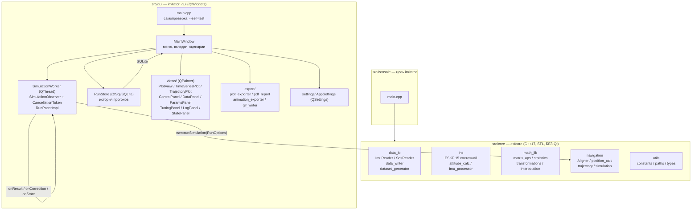
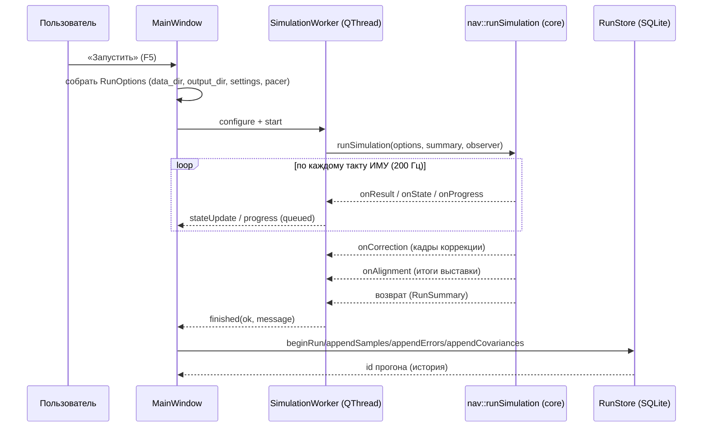

# Руководство для программиста (DEVELOPER_GUIDE.md)

## 1. Цель документа
Подробное описание архитектуры, структуры, правил разработки, сборки, тестирования, отладки и релиза консольной и Qt-версии imitator.

## 2. Общие сведения
- Рабочий каталог: `C:\ITT_Students_Qt_Version`
- Эталон: `C:\ITT_Students` (только чтение)
- Репозиторий: https://github.com/STUDENTS-ITT/ITT_Students, ветка Anton
- C++17, Qt 6.12.0 (mingw_64), CMake >= 3.16

## 3. Архитектура

Проект разделён на два логических слоя: **Qt-независимое ядро** и **Qt-оболочку**.



Ключевой принцип: ядро `core/` ничего не знает о Qt. GUI подключается к нему только через C++-интерфейсы (`RunOptions`, `SimulationObserver`, `CancellationToken`, `RunPacer`). GUI-поток наследует `SimulationObserver` (`SimulationWorker`) и вызывает `nav::runSimulation` в отдельном `QThread`.

## 4. Поток данных прогона



## 5. Конвенции core
- ESKF 15 состояний.
- Матрицы row-major, число столбцов передаётся явно: `multiply_matrix(A,B,cols_A,cols_B)`, `transpose_m(A,cols)`, `multiply_m(A,v,cols_A)`, `at(A,i,j,cols)`.
- Углы в ядре — радианы, на выходе — градусы (`RAD_TO_DEG`).
- Комментарии на русском.
- Побайтовый паритет `result.txt`/`reference.txt`/`errors.txt` при корректном `cwd` и одинаковом `settings.ini`.

## 6. Ключевые классы и типы

| Тип | Файл | Назначение |
|-----|------|-----------|
| `RunOptions` | `core/navigation/simulation.h` | Параметры прогона: `data_dir`, `output_dir`, `settings_file`, `write_files`, `capture_telemetry`, `pacer`, `speed_factor`. |
| `RunSummary` | `core/navigation/simulation.h` | Итоги: координаты выставки, начальные углы, `steps`, `corrections`, `wall_seconds`, `has_angle`. |
| `SimulationObserver` | `core/navigation/simulation.h` | Обратная связь из цикла: `onAlignment`, `onResult`, `onCorrection`, `onState`, `onProgress`. |
| `CancellationToken` | `core/navigation/simulation.h` | Проверка отмены расчёта. |
| `RunPacer` | `core/navigation/simulation.h` | Темп/пауза воспроизведения (реализуется в GUI). |
| `nav::NavState`, `nav::StepTelemetry` | `core/navigation/*` | Полное состояние и диагностика фильтра на такте. |
| `ImuReader`, `SnsReader` | `core/data_io/data_reader.h` | Чтение `imu.dat`, `gps.dat`+`angle.dat` (стыковка углов по времени). |
| `dataset::DatasetConfig/Report` | `core/data_io/dataset_generator.h` | Генерация синтетических наборов (`generateDataset`). |
| `SimulationWorker` | `gui/workers/simulation_worker.h` | GUI-обёртка: `SimulationObserver` в `QThread`, сигналы прогресса/финиша. |
| `RunStore` | `gui/core_bridge/run_store.h` | История прогонов в SQLite (`runs`, `samples`, `filter_errors`, `covariances`). |
| `PlotView` / `TimeSeriesPlot` / `TrajectoryPlot` | `gui/views/plots/*` | Графики на `QPainter` с кэшем кадров. |
| `ControlPanel` / `DataPanel` / `ParamsPanel` | `gui/views/*` | Панели управления, данных и параметров. |
| `TuningPanel` | `gui/views/tuning_panel.h` | Запуск `tools/kalman_tuner/tune_kalman.py` и применение пресетов. |
| `AppSettings` | `gui/settings/app_settings.h` | Настройки приложения (`QSettings`). |
| `nav::BiasTruth`, `loadBiasTruth` | `core/navigation/bias_report.h` | Истинные смещения набора из `params.json` и флаги наблюдаемости компонент. |
| `RunSeries::Row::ba/bg`, `RunSeries::has_bias` | `gui/core_bridge/telemetry_buffer.h` | Оценки смещений ИМУ на такте и признак, что они вообще сняты (у прогонов из истории — нет). |
| `PdfReport::biasSeries` / `biasUnit` / `biasLabel` / `biasCaption` | `gui/export/pdf_report.h` | Ряды смещений (оценка, ±2σ(P), истина), единицы и подписи — общие для вкладки «Смещения ИМУ» и блоков отчёта. |
| `PlotExporter` / `exportReportTo` / `AnimationExporter` | `gui/export/*` | Экспорт PNG/JPG/SVG/PDF/CSV/GIF и сводный PDF-отчёт. |

## 7. Структура
```
ITT_Students_Qt_Version/
├── src/{core,console,gui}
├── tests/
├── tools/            # kalman_tuner/, plot_*.py, check_no_qt_in_core.cmake
├── presets/          # tuned*.ini
├── Theory_of_Work/   # документация: user/, algorithm/, theory/
├── docs/
├── dist/             # генерируется
├── build/            # игнорируется
├── CMakeLists.txt
├── DEVELOPER_GUIDE.md
├── PROJECT_MAP.md
└── AGENTS.md
```

## 8. Сборка (quickstart)
```bash
cmake -S . -B build -G "MinGW Makefiles" -DCMAKE_PREFIX_PATH="C:/QT6.10/6.12.0/mingw_64"
cmake --build build
```
Цели: `esfcore`, `imitator`, `imitator_gui`. Release: добавить `-DCMAKE_BUILD_TYPE=Release`.
Проверка Qt-free ядра: `cmake -DITT_CORE_DIR="<abs>/src/core" -P "tools/check_no_qt_in_core.cmake"`.

## 9. Тестирование
```bash
set QT_QPA_PLATFORM=offscreen
ctest --test-dir build --output-on-failure
```
Тесты включают `core_has_no_qt`, `gui_smoke_generate`/`gui_smoke` (fixture + GUI-smoke с генерацией набора), `test_matrix_ops`, `test_transformations`, `test_statistics`, `test_ins_filter`, `test_data_io`, `test_data_source`, `test_settings`, `test_simulation`, `test_dataset_generator`, `test_gnss_guard`, `test_bias_estimate`, `test_plots`, `test_run_store`, `test_pdf_report`, `test_tuning_report`, `test_matrices_exporter`, `test_app_settings`, `test_dataset_truth`, `test_preset_meta`, `test_tuner_configs`, `test_parity`. Всего 24 теста.

## 10. PlotView
Ключ кэша — версия, размер, диапазоны X/Y. API: `setCacheEnabled`/`isCacheEnabled`/`cacheHits`/`cacheMisses`/`invalidateCache`/`isCacheValid`/`rebuildCache`. При disabled — прямая отрисовка, счётчики не растут. Курсор поверх кэша. Инвалидация обязательна при изменении отрисовки.

## 11. PDF-отчёт
`QPdfWriter`, A4, dof=9. Сохранение/восстановление series и sync_markers, графики через `renderTo()`. Блоки собирает `MainWindow::buildReportBlocks()`: траектория, по каждой величине — сам график и график её ошибки (`PdfReport::errorSeries` — знаковое отклонение от истины или эталона СНС, единицы таблицы отклонений), согласованность NIS/NEES. Таблица отклонений и графики ошибок считаются по одним парам «строка — опора» (`matchReferences` в `pdf_report.cpp`), поэтому максимум на графике совпадает с `peak` таблицы.

## 11.1. Смещения ИМУ (журнал, наблюдение, экран, отчёт)
- Ядро: `core/navigation/bias_report.{h,cpp}` — разбор `params.json` (`nav::BiasTruth` с истиной в СИ и флагами `observable[6]`), таблица приёмки (`BiasReportRow`) и запись журнала `bias.txt` (13 колонок, инженерные единицы). Точка входа консоли — `imitator --bias-report <каталог>`.
- Единицы: `ba` — мг (`kMs2ToMilliG = 1/9.80665e-3`), `bg` — °/ч (`RAD_TO_DEG·3600`) — те же, что в `params.json` и в отчёте; в СИ смещения порядка 1e-5…1e-2 и глазом не читаются.
- GUI: телеметрия несёт `NavState::ba/bg` (не путать с `x[9..14]`: компоненты вектора ошибок стремятся к нулю, а `ba`/`bg` — накопленные смещения). Они кладутся в `RunSeries::Row::ba/bg` и флаг `RunSeries::has_bias`; вкладка «Смещения ИМУ» строится `MainWindow::biasSeries()`, блоки отчёта — `PdfReport::biasSeries()` (общая сборка ряда: оценка, ±2σ(P) из диагонали `P`, истина пунктиром). Прореживание: `kMaxPlotPoints` (2000) на экран, `kMaxReportPoints` (600) в отчёт.
- Ограничение: `runs.db` не хранит `ba`/`bg` (только `result`, диагонали `P` и `NIS/NEES`), поэтому у прогона из истории `has_bias == false`, и вкладка с блоками пусты. Схема БД под это не менялась.
- Самопроверка `--self-test` проверяет вкладку (`MainWindow::biasSeriesCount()`, 24 ряда = 6 компонент × 4) и собирает два PDF: по живому прогону (с блоками смещений) и по загруженному из истории.
- Наблюдаемость: на стоянке и на прямой горизонтальные компоненты `ba`/`bg` определены только в сумме с наклоном и начальным курсом, поэтому истина таких компонент подписана «истина (ненаблюдаема)»; подробности — `docs/bias_estimation_plan.md`, раздел 6.

## 12. История/фильтр
`HistoryModel` + `QSortFilterProxyModel` (ParamsPanel), фильтр по имени/дате/каталогу, сортировка по дате по умолчанию, `mapToSource()` корректен.

## 13. Self-test, deploy, паритет
Self-test проверяет `%PDF`. Deploy формирует `dist/` (`windeployqt` + MinGW runtime + плагины). Паритет — побайтовое совпадение при корректном `cwd` и одинаковом `settings.ini`; для одновременного запуска — разные `cwd`.

## 14. Правила
core только STL/C++17, без Qt (`core_has_no_qt`). Сохранять ESKF и матричные конвенции. Графика только `QPainter`. После правок — `ctest`. `build/`, `dist/` не коммитить.

## 15. Git и релиз
Ветка Anton. `dist/` не в git; portable-пакет распространяется ZIP в GitHub Releases (`v1.0-qt-gui`, ассет `imitator_gui_portable.zip`). Ранее отслеживаемый `imitator_gui_portable.zip` выведен из git (`git rm --cached`, 2026-10-17): файл остаётся на диске и покрыт `.gitignore` (`*.zip`). Пакет собирается из `dist/*` (через `System.IO.Compression`, с прямыми слэшами) и публикуется в Releases, а не коммитится.

## 16. Отладка
`invalidateCache()` при сбое кэша; проверка series/sync_markers в PDF; `mapToSource()` в истории; `cwd` при расхождении с консолью; убрать `#include <Q...>`, если падает `core_has_no_qt`.
